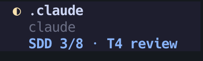

# herdr-sdd-status

A Claude Code plugin for people who run [superpowers](https://github.com/obra/superpowers) subagent-driven development (SDD) inside [herdr](https://herdr.dev). It does two things:

1. **Progress in the herdr sidebar.** The orchestrator's agent row gets a line like `SDD 3/8 · T4 review`. The numbers are read from SDD's own ledger and the plan file, so you can glance at the sidebar instead of asking the orchestrator for a status.
2. **An edit guard for the orchestrator.** While SDD runs, the orchestrator session can't use `Edit` or `Write` on project files. It is told to hand the change to a subagent. Subagents edit as usual.



The plugin doesn't touch any superpowers file. Uninstall it and SDD works exactly as before.

## Install

```
/plugin marketplace add arthurseredaa/herdr-sdd-status
/plugin install sdd-status@herdr-sdd-status
```

Then add the progress row to the herdr sidebar in `~/.config/herdr/config.toml` and run `herdr server reload-config`:

```toml
[ui.sidebar.agents]
rows = [
  ["state_icon", "machine", "workspace", "tab"],
  ["agent"],
  [{ token = "$sdd", fg = "#89b4fa", bold = true }],
]
```

The first two rows are herdr's defaults. The third shows the `$sdd` value and disappears on panes where no SDD run is going on. If you already have a custom layout, add the `$sdd` row to it.

Requirements: `jq`, herdr 0.9 or newer (for `pane report-metadata` tokens), Claude Code with plugin hooks. Outside herdr the guard still works and the label is skipped.

## What the label shows

| Label | Meaning |
| --- | --- |
| `SDD · setup` | SDD created its workspace, the ledger isn't written yet |
| `SDD 2/8` | 2 of 8 plan tasks are `complete` in the ledger |
| `SDD 2/8 · T3 impl` | Task 3 is dispatched to an implementer |
| `SDD 2/8 · T3 review` | Task 3 is implemented and under review |
| `SDD 2/8 · T3 fix 2/5` | Task 3 is in review fix round 2 of 5 |
| `SDD 2/8 · T3 impl, T5 review` | tasks running in parallel |
| `SDD 8/8 · final review` | every task is complete |

The row disappears when SDD deletes its workspace at the end of the run, or when the session ends.

The total counts `### Task N` headings in the plan (`Stage`, `Задача` and `Етап` work too). The phase depends on the orchestrator writing lines like `Task 3: dispatched` to the ledger. Some runs only log `complete` lines, and then you see just the count.

## How it works

| Hook | What it does |
| --- | --- |
| `PostToolUse` | When the session runs SDD's `sdd-workspace` script, the plugin binds the session to the workspace path it prints. After every tool call it re-reads `progress.md` and calls `herdr pane report-metadata --token sdd=…` if the label changed. |
| `PreToolUse` on `Edit\|Write\|MultiEdit\|NotebookEdit` | Denies the call when this session is a bound orchestrator, the call comes from the main agent (no `agent_id` in the hook input), and the file is outside the SDD workspace. Writes to the ledger, briefs and reports stay allowed. |
| `SessionStart`, `SessionEnd` | Clear the label and state left on the pane, for example after `/clear`. |

State lives in `~/.local/state/herdr-sdd-status/<session_id>.json`.

The guard covers file-editing tools only. An orchestrator that runs `sed -i` through Bash isn't stopped.

## Turning it off for one run

`/sdd-status:off` releases the run on the current pane: the label goes away and the orchestrator may edit files again. Only you can run it; the model can't invoke this command.

## Uninstall

```
/plugin uninstall sdd-status@herdr-sdd-status
rm -rf ~/.local/state/herdr-sdd-status
```

Remove the `$sdd` row from your herdr config if you added it.

## Development

`test/run.sh` feeds fake hook input to `bin/sdd-status` with a stub `herdr` and runs 14 checks. Set `SDD_STATUS_DEBUG=/path/to/log` to log every hook input the script receives, which is how you can check what Claude Code actually sends.

To try local changes in one session: `claude --plugin-dir /path/to/herdr-sdd-status`.

## License

MIT
